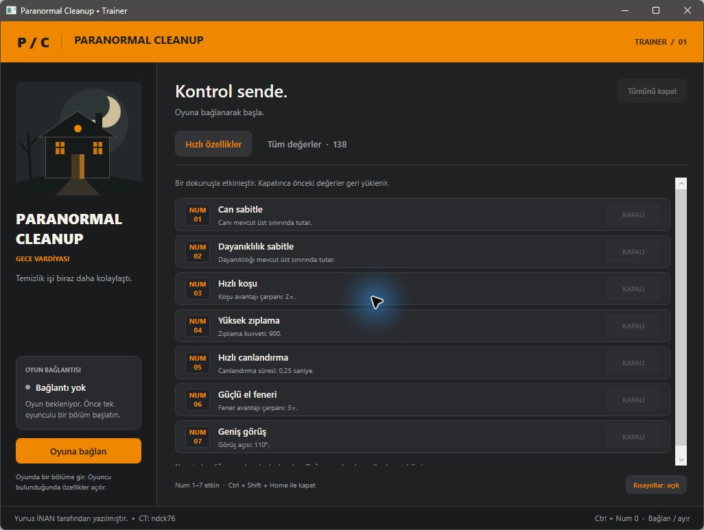
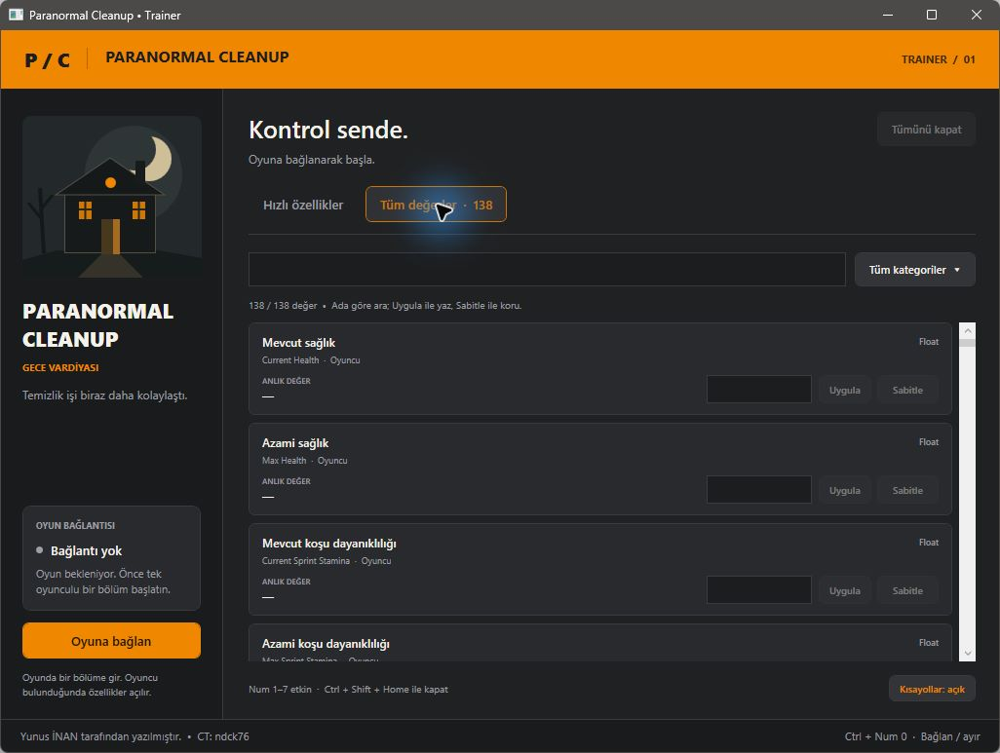

# Paranormal Cleanup — Türkçe Trainer

**Yunus İNAN tarafından yazılmıştır.**

Paranormal Cleanup için Türkçe arayüzlü, tek oyunculu kullanım odaklı Windows trainer. C# ve WPF ile geliştirilmiştir; **Cheat Engine kurulumu gerekmez.**

**[Hazır sürümü indir](https://github.com/Terabithia1572/ParanormalCleanup-Trainer/releases/latest)** · [Doğrulama](docs/VERIFICATION.md) · [Yazar ve kaynaklar](AUTHORS.md)

## Ekran görüntüleri



<details>
<summary>Tüm değerler ekranını göster</summary>



</details>

## Özellikler

- **7 hızlı seçenek:** can, dayanıklılık, koşu, zıplama, canlandırma, fener ve görüş açısı.
- **138 alan:** 128 düzenlenebilir değer ve 10 salt okunur alan.
- **7 kategori:** oyuncu, yetenekler, eldeki eşya, hayalet, maç bilgileri, oyun oturumu ve kayıt verileri.
- Türkçe/İngilizce arama, tek seferlik değer uygulama ve 250 ms aralıklarla sabitleme.
- Oyun dosyasının SHA-256 kimliğini ve çalışma anındaki alan metadatasını doğrulama.
- Tek oyunculu oturum kontrolü; bağlantı kesilirken özgün oyun kodunu geri yükleme.

## İndirme ve kullanım

1. [Releases](https://github.com/Terabithia1572/ParanormalCleanup-Trainer/releases/latest) sayfasından `ParanormalCleanup-Trainer.zip` dosyasını indirip bir klasöre çıkarın.
2. `ParanormalCleanup-Trainer.exe` ve `.exe.config` dosyalarını aynı klasörde tutun. **Windows x64 ve .NET Framework 4.8** gerekir.
3. Oyunu açıp **tek oyunculu bir bölüme** girin, ardından traineri çalıştırın.
4. **Oyuna bağlan** düğmesine veya **Ctrl + Num 0** tuşlarına basın.
5. **Oyuncu bulundu** durumunda hızlı özellikleri kullanın. **Tüm değerler** sekmesinde **Uygula** bir kez yazar, **Sabitle** değeri sürekli korur.

Num Lock açık olmalıdır. Oyun ve trainer aynı Windows yetki düzeyinde çalışmalıdır. Başka uygulamayla kısayol çakışırsa trainer bunu bildirir; düğmeler kullanılabilir.

### Kısayollar

- **Num 1:** Canı azami değerde tut.
- **Num 2:** Dayanıklılığı azami değerde tut.
- **Num 3:** Koşu çarpanını 2 yap.
- **Num 4:** Zıplama hızını 900 yap.
- **Num 5:** Canlandırma süresini 0,25 yap.
- **Num 6:** Fener çarpanını 3 yap.
- **Num 7:** Görüş açısını 110 yap.
- **Ctrl + Num 0:** Oyuna bağlan / bağlantıyı kes.
- **Ctrl + Shift + Home:** Özellik kısayollarını aç / kapat.

Bu hızlı seçeneklerin hazır değerleri bu trainer için seçilmiştir. **Can sabitle hasara bağışıklık değildir:** iki yenileme arasındaki ölümcül hasarı engellediği doğrulanmamıştır. Eşya veya hayalet gibi nesneler mevcut değilse ilgili alanlar `—` görünür.

## Uyumluluk

Hedef işlem `aCleaningHorror-Win64-Shipping.exe`. Desteklenen oyun dosyasının SHA-256 değeri:

```text
9a06f5834c8a7593e05ec92de6bfeec6cb975bae63a303a9615fbab006fbcc9e
```

Trainer yalnızca bu dosya kimliğinde çalışır. Oyun güncellenmişse, başka bir araç aynı kodu yamalamışsa veya oturum çok oyunculuysa özellikler etkinleşmez. CT'nin sürüm notu, kurulu oyunun doğrulanmış sürüm numarası değildir.

Özgün CT ile desteklenen oyun arasında **99 işaretçi zinciri farkı** düzeltilmiştir. Her alan yazılmadan önce sınıf, ad, tür, konum ve boyut bilgisi kontrol edilir. [Profil değişiklikleri](docs/verification/profile-adjustments.json).

## Geri alma davranışı

**Tümünü kapat** sabitlemeleri durdurur. Hızlı seçenekler ve sabitlemeler kapatılırken nesne aynıysa ve değer trainerin son yazdığı değerle eşleşiyorsa önceki değer geri yazılır. Oyun değeri değiştirmişse bu değişiklik korunur. Bölüm veya nesne değiştiğinde eski adrese yazılmaz ve anahtarlar sıfırlanır.

**Uygula** ile yapılan tek seferlik değişiklikler otomatik geri alınmaz. Para, deneyim ve kayıt verisi değişikliklerini oyun kalıcı kaydedebilir.

**Bağlantıyı kes** ve normal pencere kapanışı özgün 8 bayt oyun kodunu geri yükler. Bağlantı başına ayrılan 4 KiB kod alanı oyun kapanana kadar tutulur. Diskteki oyun dosyaları değiştirilmez.

## Kaynaktan derleme

Windows x64 üzerinde, proje klasöründe PowerShell ile:

```powershell
.\scripts\build.ps1 -Test
.\scripts\render-ui.ps1
```

Derleme Windows'un .NET Framework C# derleyicisini kullanır; NuGet paketi veya ek SDK indirmez. EXE ve yapılandırması proje köküne, test çıktıları `build/` ve `analysis/` klasörlerine yazılır.

Varsayılan motor testi kendi kontrollü alt sürecini kullanır ve **49 kontrol** çalıştırır. Kurulu oyun dosyasına yönelik **4 ek salt okunur kontrol** için dosya yolunu belirtin:

```powershell
$env:PARANORMAL_GAME_EXE = 'D:\Games\Paranormal Cleanup\aCleaningHorror\Binaries\Win64\aCleaningHorror-Win64-Shipping.exe'
.\scripts\build.ps1 -Test
```

`render-ui.ps1` 23 arayüz kontrolü yapar ve gerçek WPF kontrollerinden PNG önizlemeleri üretir; oyuna bağlanmaz. Yayın ZIP'ini üretmek için `scripts/package.ps1` kullanılabilir.

### Kaynak yapısı

- `src/TrainerWindow.cs`: Türkçe WPF arayüz ve kısayollar.
- `src/TrainerEngine.cs`: bağlantı, bellek erişimi ve geri alma.
- `src/UeReflection.cs`: oyuncu kimliği ve alan metadatası doğrulaması.
- `src/features.json`: 138 alanın Türkçe adları ve güncel profili.
- `tests/`: kontrollü testler, arayüz kontrolleri ve elle çalıştırılan canlı tanılama araçları.
- `docs/verification/`: doğrulama sonuçları ve profil değişiklikleri.

`scripts/update-profile.mjs`, yerel analizden üretilen `analysis/ct-features.json` ve `analysis/live-metadata.json` dosyalarını gerektiren bakım aracıdır. Normal derlemede çalıştırılmaz; gerekli profil `src/features.json` içinde hazırdır.

## Doğrulama durumu

**53 motor/profil kontrolü ve 23 arayüz kontrolü geçti.** Gerçek tek oyunculu oyunda 138 alanın okunması, 7 hızlı seçeneğin bellek değerlerini değiştirip geri yüklemesi ve özgün kodun geri yüklenmesi doğrulandı.

Her özelliğin oyun mekaniğine nihai etkisi, fiziksel Num tuşlarıyla oyun içi kullanım, bölüm geçişleri ve uzun süreli oynanış ayrıca doğrulanmadı. Kapsam ve sonuçlar [doğrulama notlarında](docs/VERIFICATION.md) bulunur.

## Geliştirici ve teşekkür

**Geliştirici: [Yunus İNAN](https://github.com/Terabithia1572).**

Başlangıç CT tablosunun yazarı **ndck76**. `sons-tr.exe` görsel ve kullanım referansı olarak [REA](https://github.com/morluto/rea) ile incelendi. Bu trainerin arayüzü ve bellek motoru ayrı kaynak kod olarak yazıldı. Ayrıntılar [AUTHORS.md](AUTHORS.md) dosyasındadır.
